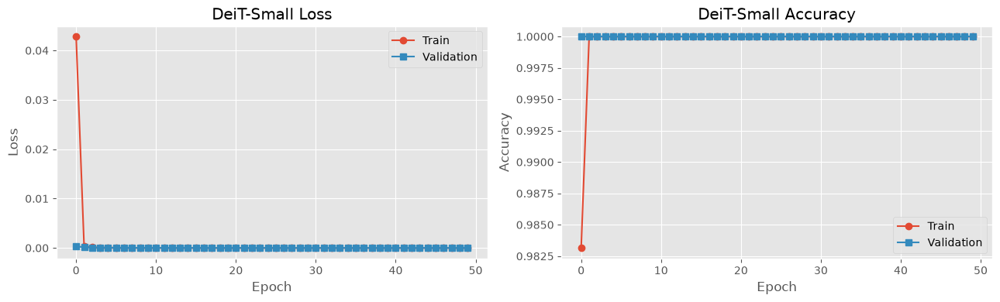
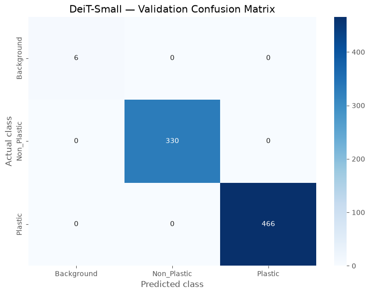
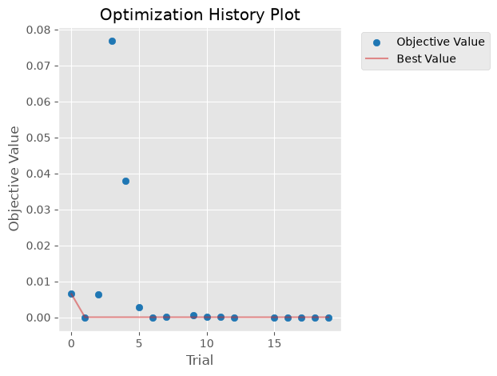

# Plastic Waste Classification with Vision Transformers

Image classification of **plastic waste vs. non-plastic objects vs. empty background**, comparing five
pretrained vision transformer approaches (CLIP zero-shot, ViT-B/16, DINOv2 ViT-S/14, DINOv2 ViT-B/14, DeiT-Small),
with Optuna hyperparameter search and live webcam inference. Built as a perception component for a
plastic-sorting setup.

## Models compared

| # | Model | Checkpoint | Approach |
|---|-------|-----------|----------|
| 1 | CLIP ViT-B/32 | `openai/clip-vit-base-patch32` | Zero-shot, three text prompts, no training |
| 2 | ViT-B/16 | `google/vit-base-patch16-224` | Full fine-tuning, class-weighted loss, 20 epochs |
| 3 | DINOv2 ViT-S/14 | `facebook/dinov2-small` | Frozen backbone + linear head, Optuna (20 trials) |
| 4 | DINOv2 ViT-B/14 | `facebook/dinov2-base` | Cached CLS features + linear head, Optuna (20 trials) |
| 5 | DeiT-Small | `deit_small_patch16_224` (timm) | Head-only or full fine-tuning, Optuna (20 trials) |

## Dataset

4,007 images in three classes (not included, see [`data/README.md`](data/README.md)):

| Class | Images |
|-------|-------:|
| Background | 28 |
| Non_Plastic | 1,737 |
| Plastic | 2,242 |

80/20 split (3,205 train / 802 validation), seed 42. `Background` is very small, so the
ViT-B/16 and DINOv2 runs use class-weighted cross-entropy.

## Results

| Model | Best validation accuracy | Best validation loss |
|-------|-------------------------:|---------------------:|
| ViT-B/16 (fine-tuned) | 100% | 5.7e-07 |
| DINOv2 ViT-S/14 | 100% | ~0 |
| DINOv2 ViT-B/14 | 100% | ~0 |
| DeiT-Small | 100% (802/802) | 3.0e-07 |
| CLIP ViT-B/32 (zero-shot) | not measured, see below | n/a |

**CLIP zero-shot:** it predicted *plastic* for only 444 of the 4,007 images, while the dataset contains
2,242 plastic images. Plastic recall is therefore at most ~20% with these prompts. All 28 background
images were predicted as background.

<p align="center">
  <br>
  
  
</p>

## Limitations: read the 100% with care

Every fine-tuned model scores 100% on validation. That is evidence the task is easy *on this data split*,
not evidence of 100% accuracy in deployment:

- **Likely near-duplicate leakage.** Filenames look like millisecond timestamps, and consecutive background
  frames are about 250 ms apart with identical CLIP scores. A random split puts almost the same frame in
  both train and validation.
- **No held-out test set.** Optuna selected hyperparameters on the same validation set used for reporting.
- **Splits differ slightly between models.** DeiT used `random_split` (6/330/466 per class in validation);
  the others used a stratified split (5/348/449), so the numbers are not on identical images.
- **Only 28 background images** (5 in validation), so background metrics are very noisy.

Suggested next steps: split by capture session or time block, keep a separate test set from a different
scene/lighting/camera position, and evaluate on images the models have never seen.

## Repository structure

```
.
├── notebooks/plastic_vit_classification.ipynb   # all experiments, outputs included
├── scripts/inference.py                         # image + webcam inference (DeiT-Small)
├── data/README.md                               # expected dataset layout
├── docs/figures/                                # images used in this README
├── requirements.txt
├── LICENSE
└── README.md
```

Training writes outputs next to the notebook's project root (`best_vit_model/`, `dinov2_model/`,
`dinov2_base_model/`, `deit_small_model/`, `model_comparison/`). Weights (`*.pth`, `*.safetensors`) are
git-ignored.

## Setup

```bash
git clone https://github.com/<your-username>/<repo-name>.git
cd <repo-name>

python -m venv .venv
source .venv/bin/activate          # Windows: .venv\Scripts\activate

# GPU users: install the CUDA build of PyTorch first (https://pytorch.org/get-started/locally/)
pip install -r requirements.txt
```

Tested with Python 3.11, PyTorch 2.11 (CUDA 12.8) and an NVIDIA RTX 5060 laptop GPU (8 GB). Batch sizes and
the feature-extraction batch size were chosen to fit that card; reduce them if you run out of memory.

## Usage

**Reproduce the experiments:** put the dataset in `data/` and run the notebook top to bottom:

```bash
jupyter lab notebooks/plastic_vit_classification.ipynb
```

**Run inference** with the DeiT-Small checkpoint produced by section 5 of the notebook:

```bash
# Images and/or folders
python scripts/inference.py --image path/to/photo.jpg path/to/folder/ --csv predictions.csv

# Live webcam (Q to quit, S to save a frame)
python scripts/inference.py --webcam
```

Default checkpoint path is `deit_small_model/best_model.pth`; override with `--checkpoint`.


## License

Code is released under the [MIT License](LICENSE). The dataset and pretrained model weights have their own
licences; check them before redistributing.
